# Torque Lab Native — System Architecture (`ARCHITECTURE.md`)

**Project:** Torque Lab Native  
**Target Platform:** Native Windows Desktop (`x86_64`)  
**Technology Stack:** C++20, OpenGL 3.3 Core Profile, GLSL 330 core, GLFW 3.4, GLAD, Bullet Physics (`LinearMath`, `BulletCollision`, `BulletDynamics`), Dear ImGui, CMake.

---

## 1. Architectural Principles

1. **Strict Separation of Simulation and Presentation:**
   - The physics and vehicle dynamics layer (`src/physics/`, `src/vehicle/`) has **zero** dependency on OpenGL, GLFW, or Dear ImGui.
   - This allows the exact same physics library (`TorqueLabPhysics`) to be linked into both the interactive desktop application (`TorqueLabNative`) and the headless automated validation test runner (`TorqueLabNativeTests`).
2. **Deterministic Fixed-Timestep Simulation with Render Interpolation:**
   - The simulation steps at a fixed $\Delta t = \frac{1}{120}\text{ s}$ (`8.333 ms`) with an accumulator and spiral-of-death clamp (`maxSubSteps = 12`).
   - Prior and current chassis/wheel transforms are stored on every fixed step and interpolated by $\alpha = \text{accumulator} / \Delta t \in [0, 1]$ for jitter-free rendering at arbitrary monitor refresh rates.
3. **Custom Vehicle Dynamics on Top of Bullet Rigid-Body & Raycast Primitives:**
   - Bullet Physics provides the 6-DOF rigid-body integrator (`btDiscreteDynamicsWorld`, `btRigidBody`), compound collision shapes (`btCompoundShape`, `btBoxShape`), narrowphase contact manifolds, and world raycasting (`btCollisionWorld::ClosestRayResultCallback`).
   - All vehicle dynamics—independent suspension springs/dampers/bump-stops/anti-roll bars, Pacejka tire slip & friction-circle saturation, 8-substep wheel rotational inertia, Ackermann speed-sensitive steering, engine/transmission/LSD drivetrain, brakes, and aerodynamics—are implemented explicitly in our modular C++20 classes.

---

## 2. High-Level Component Diagram

```mermaid
flowchart TD
    subgraph AppLayer["Application & Loop (src/app/)"]
        Main["main.cpp"] --> App["Application (GLFW Window, Timing Loop)"]
    end

    subgraph InputUILayer["Input & Dear ImGui UI (src/input/, src/ui/)"]
        Input["InputControllerGLFW (Keyboard + Gamepad)"]
        UI["ImGuiDashboard (HUD, Telemetry Table, 4-Band Oscilloscope, Live Tuning)"]
    end

    subgraph RenderLayer["OpenGL 3.3 Core Renderer (src/renderer/, shaders/)"]
        Shader["Shader & ShadowMapFBO (2048x2048 PCF)"]
        MeshTex["Mesh & Procedural Texture2D"]
        VehRen["VehicleRendererGL (Coupe, 4 Wheels, Knuckles, Struts)"]
        TrkRen["TrackRendererGL (Proving Ground & Markers)"]
        DbgRen["DebugOverlayGL (3D Force Vectors & Friction Circles)"]
        Cam["CameraControllerGL (Follow, Orbit, Suspension, Hood)"]
    end

    subgraph PhysicsLayer["Core Physics & Vehicle Dynamics (src/physics/, src/vehicle/)"]
        PW["PhysicsWorld (btDiscreteDynamicsWorld, Track Colliders, 120Hz Accumulator)"]
        VD["VehicleDynamics (Step Orchestrator & Telemetry Snapshot)"]
        VB["VehicleBody (btRigidBody, CoM Offset Transform, Contact Collector)"]
        Susp["SuspensionSystem (Spring, Asymmetric Damper, Bump Stop, ARB)"]
        Tire["TireModel (Load Sensitivity, Slip κ/α, Pacejka, Friction Circle)"]
        Drv["Drivetrain (Torque Curve, Auto/Manual 6-Speed, Launch Clutch, LSD)"]
        Steer["SteeringSystem (Speed-Sensitive + Ackermann)"]
        Brk["BrakeSystem (Front-Biased Service + Rear Handbrake)"]
        Aero["Aerodynamics (Quadratic Drag, Downforce, Rolling Resistance)"]
        Surf["SurfaceSystem (6 Surface Types & Collider Mapping)"]
    end

    App --> Input
    App --> UI
    App --> PW
    App --> VehRen
    App --> TrkRen
    App --> DbgRen
    App --> Cam

    PW --> VD
    PW --> Surf
    VD --> VB
    VD --> Susp
    VD --> Tire
    VD --> Drv
    VD --> Steer
    VD --> Brk
    VD --> Aero
```



---

## 3. Directory and File Layout

```text
TorqueLab/
├── CMakeLists.txt                       # Root CMake configuration (FetchContent: GLFW, Bullet3, ImGui; targets: TorqueLabPhysics, TorqueLabNative, TorqueLabNativeTests)
├── CMakePresets.json                    # Configure/build presets for Windows (Ninja / Visual Studio / MinGW)
├── docs/
│   ├── MIGRATION_AUDIT.md               # Complete audit of existing web application
│   ├── ARCHITECTURE.md                  # Native C++20 / OpenGL / Bullet architecture
│   ├── FEATURE_PARITY_MATRIX.md         # 1-to-1 feature mapping & verification matrix
│   ├── PHYSICS_BASELINE.md              # Exact mathematical model, SI parameters, and test baselines
│   ├── MIGRATION_PLAN.md                # Staged execution plan & risk mitigation
│   └── TEST_RESULTS.md                  # Comparative numerical verification results (Web vs Native)
├── third_party/
│   └── glad/                            # Self-contained OpenGL 3.3 Core loader (glad.h, glad.c, khrplatform.h)
├── shaders/
│   ├── phong_shadow.vert                # Vertex shader for lit/shadowed meshes (world pos, normal, UV, light-space pos)
│   ├── phong_shadow.frag                # Fragment shader (hemisphere ambient, directional sun + PCF shadow, emissive, fog)
│   ├── shadow_depth.vert                # Light-space depth pass vertex shader
│   ├── shadow_depth.frag                # Light-space depth pass fragment shader
│   ├── debug_line.vert                  # 3D debug gizmo vertex shader (per-vertex color)
│   └── debug_line.frag                  # 3D debug gizmo fragment shader
├── src/
│   ├── app/
│   │   ├── main.cpp                     # Native entry point & CLI flags (--smoke-test, --run-validation)
│   │   ├── Application.h
│   │   └── Application.cpp              # Window lifecycle, OpenGL context, main loop, subsystem coordination
│   ├── physics/
│   │   ├── Math3D.h                     # Vec3, Quat, Mat4, basis vectors, Euler pitch/roll/yaw, slerp
│   │   ├── SurfaceSystem.h
│   │   ├── SurfaceSystem.cpp            # 6 road surfaces & collider ID mapping
│   │   ├── PhysicsWorld.h
│   │   └── PhysicsWorld.cpp             # Bullet world setup, Proving Ground geometry, raycasting, 120 Hz accumulator
│   ├── vehicle/
│   │   ├── VehicleConfig.h              # VehicleConfig struct & default baseline factory
│   │   ├── WheelState.h                 # Per-wheel state & telemetry structs
│   │   ├── SuspensionSystem.h
│   │   ├── SuspensionSystem.cpp         # Spring, damper, bump stop, anti-roll bar calculations
│   │   ├── TireModel.h
│   │   ├── TireModel.cpp                # Slip ratio, slip angle, load sensitivity, Pacejka + friction circle
│   │   ├── SteeringSystem.h
│   │   ├── SteeringSystem.cpp           # Rate limiting, speed sensitivity, Ackermann geometry
│   │   ├── Drivetrain.h
│   │   ├── Drivetrain.cpp               # Engine curve, rev limiter, gearbox, clutch, viscous LSD
│   │   ├── BrakeSystem.h
│   │   ├── BrakeSystem.cpp              # Biased service brakes & rear handbrake
│   │   ├── Aerodynamics.h
│   │   ├── Aerodynamics.cpp             # Quadratic drag, downforce, rolling resistance
│   │   ├── VehicleBody.h
│   │   ├── VehicleBody.cpp              # Bullet btRigidBody + btCompoundShape CoM offset wrapper
│   │   ├── VehicleDynamics.h
│   │   └── VehicleDynamics.cpp          # Full 4-wheel vehicle step orchestrator & telemetry snapshot
│   ├── renderer/
│   │   ├── Shader.h
│   │   ├── Shader.cpp                   # GLSL compilation, linking, uniform caching, multi-path shader lookup
│   │   ├── Mesh.h
│   │   ├── Mesh.cpp                     # VAO/VBO/EBO RAII wrapper + procedural Box, Cylinder, Torus, Sphere, Plane, Ring generators
│   │   ├── Texture2D.h
│   │   ├── Texture2D.cpp                # Procedural 256x256 surface texture generator (grid, noise, stripes)
│   │   ├── ShadowMapFBO.h
│   │   ├── ShadowMapFBO.cpp             # Depth framebuffer object for directional shadow mapping
│   │   ├── VehicleRendererGL.h
│   │   ├── VehicleRendererGL.cpp        # Multi-part car chassis, wheels, rotors, calipers, struts, lights, steering wheel
│   │   ├── TrackRendererGL.h
│   │   ├── TrackRendererGL.cpp          # Proving Ground track elements, reference lines, distance posts, handling ring
│   │   ├── DebugOverlayGL.h
│   │   ├── DebugOverlayGL.cpp           # Dynamic line/arrow/circle batching for 3D force & friction circle gizmos
│   │   ├── CameraControllerGL.h
│   │   └── CameraControllerGL.cpp       # Follow, Orbit, Suspension Rig, and Driver Hood cameras
│   ├── input/
│   │   ├── InputControllerGLFW.h
│   │   └── InputControllerGLFW.cpp      # GLFW key/mouse/scroll/gamepad polling & progressive pedal ramping
│   └── ui/
│       ├── ImGuiDashboard.h
│       └── ImGuiDashboard.cpp           # Dear ImGui HUD, G-G diagram, 4-wheel table, 4-band oscilloscope, live tuning
└── tests/
    └── native_validation_tests.cpp      # Automated C++ test runner (8 Unit Suites + 10 Validation Scenarios A–J)
```

---

## 4. Rendering Pipeline Architecture

Each frame in `Application::render()` executes two OpenGL passes followed by the Dear ImGui overlay pass:

1. **Pass 1 — Directional Shadow Depth Pass (`ShadowMapFBO`):**
   - Binds the `2048x2048` (or `1024x1024` in Medium quality; skipped in Low quality) depth FBO.
   - Computes an orthographic light-space projection-view matrix $\mathbf{M}_{\text{light}} = \mathbf{P}_{\text{ortho}}(-95, 95, -95, 95, 10, 280) \cdot \mathbf{V}_{\text{sun}}$ centered on the vehicle's world position $\mathbf{p}_{\text{car}}$ with sun offset $(+45, +75, +35)\text{ m}$.
   - Renders shadow-casting track obstacles/ramps/bumps and the vehicle chassis + wheels using `shaders/shadow_depth.vert/.frag`.
2. **Pass 2 — Main Lit & Shadowed Scene Pass (`phong_shadow.vert/.frag` & `debug_line.vert/.frag`):**
   - Clears color and depth buffers to sky slate `#0f172a` (`rgb(15, 23, 42)`).
   - Renders all Proving Ground track boxes, lane markings, distance posts, and handling ring via `TrackRendererGL`.
   - Renders opaque chassis parts, wheels, knuckles, and coilover struts, followed by alpha-blended cabin glass via `VehicleRendererGL`.
   - If 3D force gizmos (`G`) are enabled, streams dynamic vertex buffers for suspension rays, normal load arrows, horizontal tire force arrows, ground friction circles, CoM marker, chassis basis/velocity/acceleration arrows, and collision contact markers via `DebugOverlayGL`.
3. **Pass 3 — Dear ImGui HUD & Telemetry Overlay (`ImGuiDashboard`):**
   - Renders crisp dock-free translucent telemetry windows:
     - **Top Bar:** Brand header, Proving Ground Zone preset buttons (`1`–`7`), simulation control buttons (`Pause`, `Reset`, `Camera`, `3D Vectors`, `Telemetry`, `Verify Physics`), and Graphics Quality combo box.
     - **Left Controls Guide & Live Tuning Lab:** Driving keybindings, Drivetrain Layout combo (`RWD`/`FWD`/`AWD`), 12 live physics sliders, and `Defaults` button.
     - **Right Physics Telemetry & Oscilloscope:** Solver timing summary, 4-wheel live telemetry table with compression bars and status dots, and custom `ImDrawList` 4-band real-time oscilloscope (`Speed`, `Long/Lat Accel`, `Pitch/Roll`, `4-Wheel Suspension Travel`).
     - **Bottom Instrument Cluster:** Speedometer (`km/h` & `m/s`), Gear & `AUTO`/`MAN` indicator, RPM progress bar with redline highlight, Throttle/Brake/Steering bars, custom `ImDrawList` 2D G-G diagram circle & dot, Pitch/Roll readouts, and color-coded active surface badge.
